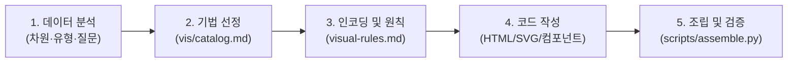

# `illustrate` — 순수 데이터 시각화 스킬

`illustrate`는 박현우 교수의 시각화 분류 체계([vis.hwpark.net](https://vis.hwpark.net))의 95개 기법과 20대 원칙을 바탕으로, 데이터 구조와 전달 목적에 맞는 최적의 시각화를 설계하고 독립 실행 가능한 웹 그래픽(HTML/SVG/Canvas)으로 조립·생성하는 전문 시각화 스킬입니다.

---

## 1. 핵심 철학 및 작업 흐름

### 단계별 상세 가이드

1. **데이터 및 목표 분석**:
   - 데이터 차원: 단변량(1D), 이변량(2D), 다변량(ND), 시계열, 계층, 네트워크, 공간 등.
   - 데이터 속성: 명목형(Nominal), 서열형(Ordinal), 등간/비율형(Continuous/Interval).
   - 전달 목적: 비교(Comparison), 추세(Trend), 분포(Distribution), 상관(Relationship), 구성비(Composition), 지리/공간(Geographic).

2. **기법 선정 (`references/vis/catalog.md`)**:
   - [visual-rules.md](references/visual-rules.md)의 [데이터 구조 → 시각화 기법 매핑] 표를 참조합니다.
   - 세부 후보 기법의 명세(`references/vis/techniques/<slug>.md`)에서 **적용 시점**, **피해야 할 조건**, **대안 기법**을 확인합니다.

3. **인코딩 규칙 및 지각 원칙 적용**:
   - 그래픽 인코딩 순위: 위치 > 길이 > 방향/기울기 > 각도 > 면적 > 부피 > 채도 > 색조.
   - 20대 원칙 점검: 접근성(대비 4.5:1, 색 외 2차 단서), 직접 라벨링, 일관성, 데이터-잉크 비율 극대화, 게슈탈트 원리 준수.

4. **컴포넌트 및 코드 구현**:
   - 내장 컴포넌트: `chart` (막대/선/산점도), `waterfall` (폭포 차트), `histogram` (히스토그램), `heatmap` (히트맵/상관행렬), `venn` (벤 다이어그램), `diagram` (트리/네트워크/상태전이), `steps` (단계별 흐름), `model` (동적 매개변수 슬라이더), `focus` (연동 강조).
   - 커스텀 다이어그램: `references/diagram.md`의 표준 SVG 규칙(반응형 `viewBox`, 시맨틱 그룹핑 `<g>`, 접근성 `<title>/<desc>`)에 따라 순수 SVG로 작성합니다.

5. **단일 HTML 조립 및 검증**:
   - `python3 scripts/assemble.py <fragment.html> <output.html> --title "시각화 제목"` 명령어로 컴파일합니다.
   - Spoqa Han Sans Neo 폰트 자동 서브셋팅, KaTeX 수식 렌더링, 공통 CSS 변수 및 컴포넌트 스크립트가 하나의 완전 독립형 파일로 인라인 통합됩니다.

---

## 2. 지원 컴포넌트 (`data-illustrate="..."`)

| 컴포넌트 | 태그 / 속성 예시 | 주요 용도 |
|---|---|---|
| `chart` | `
...
` | 범주별 막대 차트, 시계열 선 그래프, 2변량 산점도 |
| `waterfall` | `
...
` | 시작값에서 단계별 증감을 거쳐 최종 누계로 이어지는 흐름 |
| `histogram` | `
...
` | 단일 연속형 변수의 구간별 빈도 및 분포 |
| `heatmap` | `
...
` | 2차원 매트릭스, 상관행렬, 혼동행렬, 인접행렬 |
| `venn` | `
...
` | 2~3개 집합 간 교집합 및 포함 관계 |
| `diagram` | `
...
` | 트리, 계통도, 방향성 그래프(DAG), 상태 기계 |
| `steps` | `
...
` | 단계별 절차, 알고리즘 실행, 스크러빙 재생 |
| `model` | `
...
` | 수식/파라미터 슬라이더 조작에 따른 실시간 그래프 연동 |
| `focus` | `
...
` | 다중 시각화 간 마우스 호버/클릭 연동 하이라이트 |

---

## 3. 핵심 참조 문서

- [references/visual-rules.md](references/visual-rules.md): 95개 기법 선택 가이드 및 20대 시각화 원칙 체크리스트
- [references/vis/catalog.md](references/vis/catalog.md): 95개 시각화 기법 색인
- [references/chart.md](references/chart.md): 수치형 차트 설계 및 축/스케일 규칙
- [references/diagram.md](references/diagram.md): 구조형 다이어그램 및 SVG 규칙
- [references/components.md](references/components.md): 내장 컴포넌트 설정 및 마크업 규격
- [references/style.md](references/style.md): 디자인 토큰, 색상 팔레트, 타이포그래피 시스템
